# Río Claro | Centro Inteligente de Operaciones

## Proyecto final AI-901

**Autor:** Antonio J. Bustamante  
**Solución:** Implementación funcional en fase piloto  
**Acceso público:** [Abrir Río Claro](https://rioclaro-ai-antonio-ctbwene8g7b4f7fr.westus3-01.azurewebsites.net)  
**Plataforma:** Microsoft Azure App Service + Microsoft Foundry + Python/FastAPI

> **Nota de alcance:** la solución es funcional y está desplegada en Azure. Los datos operativos incluidos son ficticios y se utilizan exclusivamente para demostración. No representan información empresarial real y no deben utilizarse para decisiones operativas o financieras.

---

## 1. Resumen ejecutivo

Río Claro es un Centro Inteligente de Operaciones que integra información operativa, analítica local y conocimiento documental en una sola experiencia web. La solución fue diseñada para apoyar a personal de bodega, ventas, compras y atención al cliente mediante consultas en lenguaje natural, interacción por voz, indicadores ejecutivos y acceso desde computadora o celular.

La arquitectura es híbrida:

- **Datos estructurados locales:** inventario, productos, ventas, compras, pedidos y quejas demostrativas.
- **Motor analítico:** conteos, sumas, rankings, filtros, agrupaciones y manejo de empates.
- **Microsoft Foundry:** respuestas conceptuales, procedimentales y documentales sustentadas en conocimiento autorizado.
- **Azure App Service:** publicación de la aplicación como servicio web accesible desde un navegador.

La solución evita presentar datos ficticios como información real, muestra fuentes y limitaciones, protege solicitudes sensibles y mantiene las decisiones críticas bajo supervisión humana.

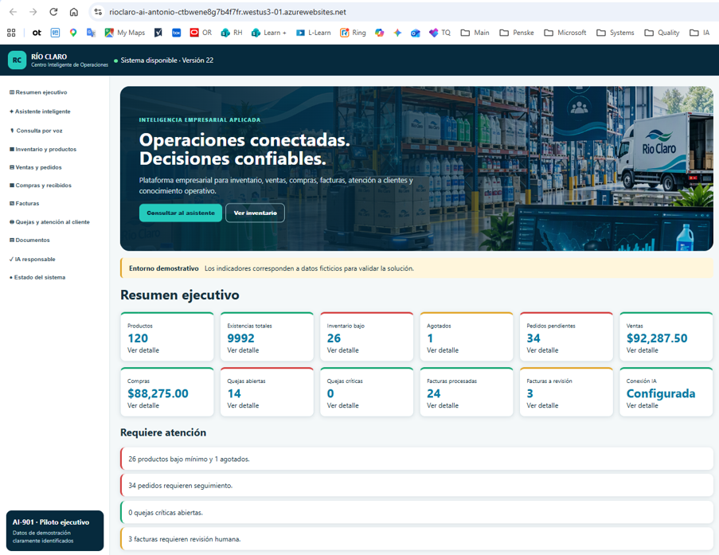

> **Figura 1. Centro Inteligente de Operaciones Río Claro.** Aplicación web desplegada en Azure App Service con navegación empresarial, Resumen ejecutivo, indicadores tipo semáforo y alertas operativas. Los datos mostrados son ficticios y se utilizan exclusivamente para demostrar las capacidades de la solución.

---

## 2. Problema empresarial

Distribuidora Río Claro requiere mejorar la disponibilidad y comprensión de información relacionada con inventario, pedidos, compras, ventas, quejas y documentación operativa. En un escenario tradicional, el personal debe consultar fuentes separadas, interpretar manualmente registros y escalar preguntas frecuentes a especialistas.

Los principales retos atendidos son:

1. Dificultad para localizar información operativa con rapidez.
2. Falta de una vista ejecutiva única para excepciones y alertas.
3. Necesidad de consultar procedimientos y políticas autorizadas.
4. Dependencia de procesos manuales para clasificar y resumir información.
5. Requerimiento de acceso desde celular o mediante voz para personal operativo.
6. Riesgo de respuestas sin fuente, datos inventados o decisiones no autorizadas.

---

## 3. Objetivos

### Objetivo general

Implementar una solución funcional de inteligencia artificial que concentre consultas operativas, análisis y conocimiento documental de Río Claro, con acceso web, experiencia móvil, interacción por voz y controles de IA responsable.

### Objetivos específicos

- Consultar inventario por SKU, estado, categoría, ubicación y sucursal.
- Detectar productos agotados o por debajo del nivel mínimo.
- Consultar y analizar ventas, compras, pedidos y quejas.
- Realizar agrupaciones, rankings y comparaciones con manejo de empates.
- Responder preguntas conceptuales mediante Microsoft Foundry y conocimiento autorizado.
- Mostrar un Resumen ejecutivo con semáforos y alertas interactivas.
- Permitir altas demostrativas de productos, operaciones y quejas.
- Proporcionar interacción por texto y voz.
- Mantener fuentes, limitaciones y revisión humana visibles.

---

## 4. Usuarios objetivo

| Usuario | Necesidad principal | Capacidad de Río Claro |
|---|---|---|
| Personal de bodega | Consultar existencias y productos por reabastecer | Inventario por SKU, mínimos, estado, ubicación y sucursal |
| Personal de ventas | Consultar pedidos, clientes y montos | Filtros, agregaciones y rankings de ventas y pedidos |
| Personal de compras | Revisar compras y contrapartes | Conteos, montos, estatus y análisis de compras |
| Atención al cliente | Registrar y consultar quejas | Alta, clasificación, prioridad, estatus y análisis de frecuencia |
| Supervisión | Identificar excepciones | Resumen ejecutivo, semáforos, tendencias y alertas |
| Usuario general | Consultar procedimientos | Agente de Microsoft Foundry con conocimiento autorizado |

---

## 5. Solución implementada

### 5.1 Resumen ejecutivo

El tablero presenta indicadores demostrativos de productos, existencias, inventario bajo, agotados, pedidos pendientes, ventas, compras, facturas y quejas. Los colores facilitan la identificación de condiciones normales, preventivas y críticas.

La sección **Requiere atención** permite navegar hacia el detalle asociado.

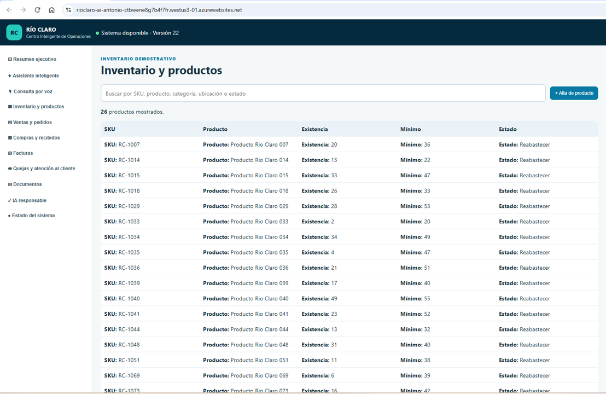

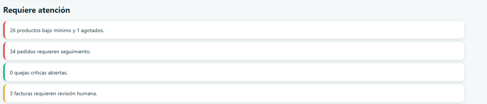

> **Figura 15. Navegación interactiva de alertas.** La alerta de 26 productos bajo mínimo conduce al módulo Inventario y productos, donde se presenta el detalle filtrado con SKU, existencia, mínimo y estado Reabastecer.

### 5.2 Inventario y productos

La aplicación acepta consultas por SKU con o sin guion y recupera datos estructurados. También permite buscar productos y registrar altas demostrativas.

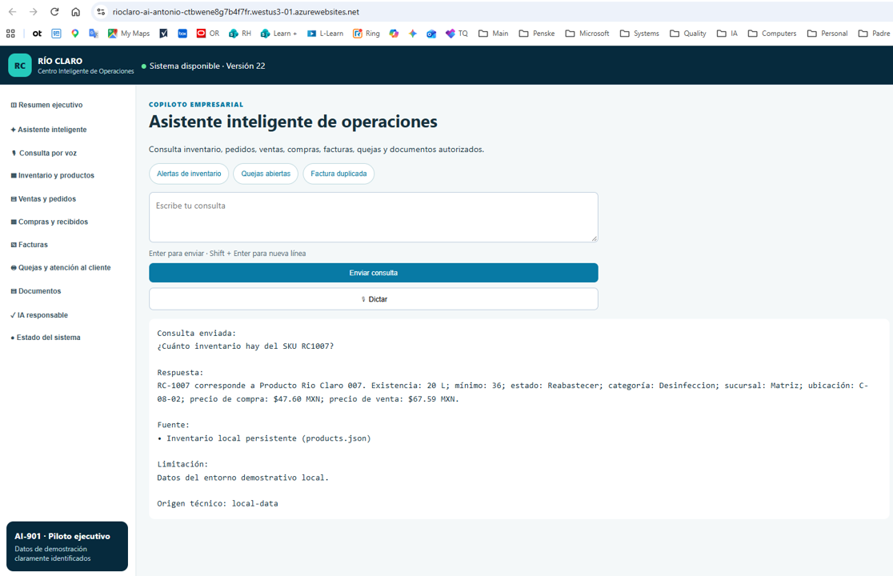

> **Figura 2. Consulta operativa de inventario por SKU.** El asistente normaliza RC1007 como RC-1007 y recupera existencia, mínimo, estado, categoría, sucursal, ubicación y precios desde el inventario local persistente.

### 5.3 Analítica local

El motor analítico interpreta intención, métrica, dimensión, filtros, orden y empates. Esto evita responder con listados generales cuando la pregunta solicita un máximo, ranking o agregación.

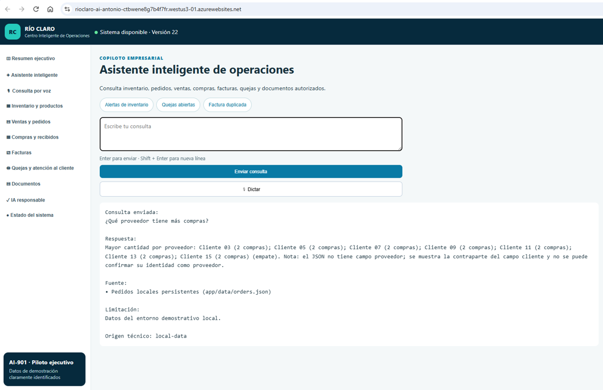

> **Figura 3. Análisis agregado de compras y manejo de empates.** El motor agrupa las operaciones de compra por la contraparte disponible e identifica todas las coincidencias con la cantidad máxima. La respuesta transparenta la limitación del campo de contraparte en el modelo demostrativo.

### 5.4 Quejas y atención al cliente

El módulo permite registrar cliente, categoría, prioridad y descripción; genera un folio y establece el estado inicial.

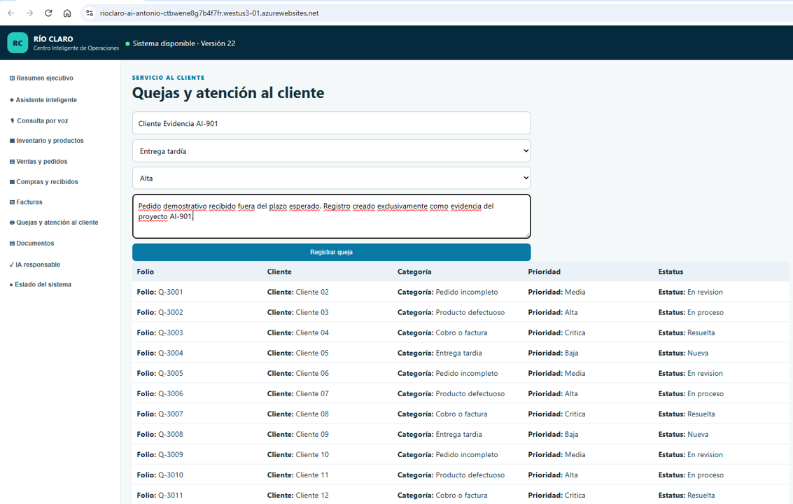

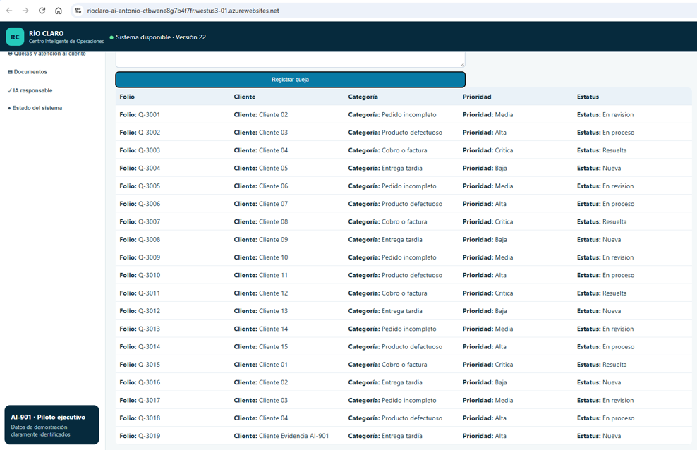

> **Figura 8. Registro demostrativo de una queja.** La aplicación genera el folio Q-3019 y asigna el estado inicial Nueva. Los datos fueron creados exclusivamente como evidencia del proyecto.

### 5.5 Facturas e inteligencia documental

El módulo permite cargar un archivo y generar una evaluación inicial estructurada. Esta función es demostrativa y no realiza OCR, validación fiscal ni autorización de pagos.

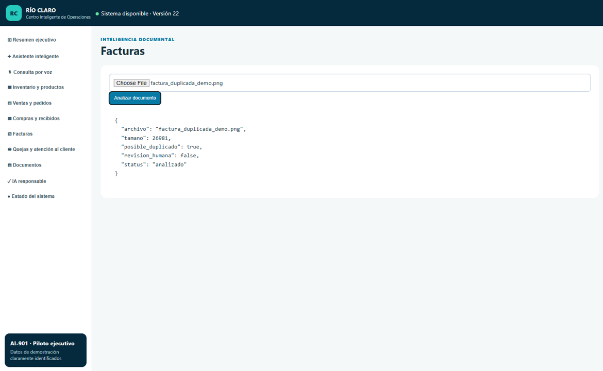

> **Figura 9. Análisis inicial de una factura demostrativa.** La aplicación procesa un archivo ficticio y reporta nombre, tamaño, estado y señal de posible duplicado. Cualquier coincidencia requiere revisión humana.

### 5.6 Consulta por voz

El módulo de voz reconoce la pregunta, muestra el texto interpretado, ejecuta la consulta, presenta la respuesta y puede reproducirla. El audio no se almacena.

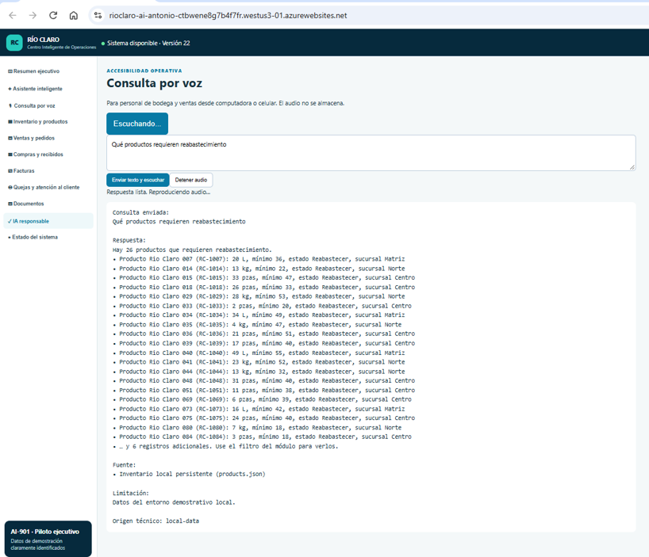

> **Figura 6. Consulta operativa mediante voz.** La solución reconoce una pregunta hablada sobre reabastecimiento, consulta el inventario y reproduce la respuesta, manteniendo visibles la fuente, las limitaciones y el control para detener el audio.

### 5.7 Experiencia móvil

La interfaz adapta navegación, portada, botones y tarjetas a una pantalla vertical.

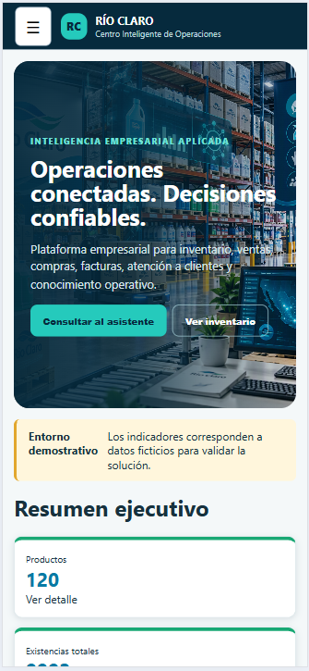

> **Figura 7. Experiencia móvil de Río Claro.** La navegación tipo hamburguesa y la distribución vertical permiten utilizar la solución desde dispositivos móviles.

---

## 6. Arquitectura de la solución

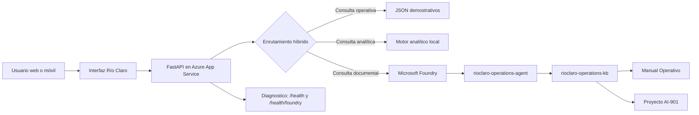

### Flujo de enrutamiento

1. Se aplican controles locales de seguridad.
2. Las consultas operativas reconocidas utilizan datos estructurados.
3. Las consultas analíticas utilizan el motor local.
4. Las consultas conceptuales o documentales se envían a Microsoft Foundry.
5. El fallback se utiliza únicamente si ninguna fuente puede responder.

---

## 7. Microsoft Foundry y conocimiento autorizado

Las preguntas conceptuales se resuelven mediante un agente que utiliza documentación aprobada.

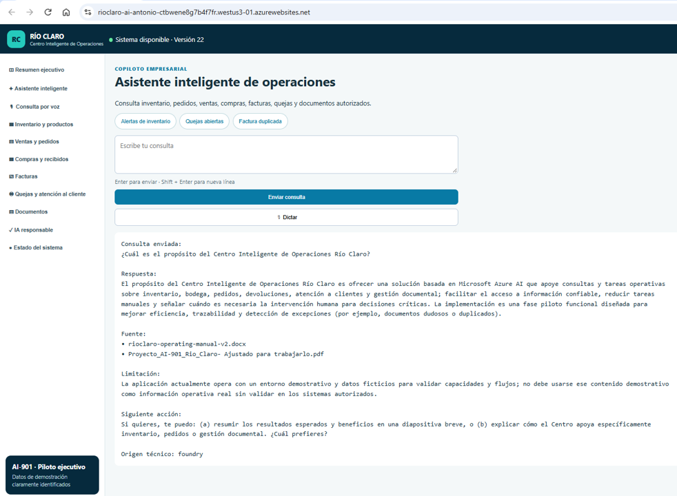

> **Figura 4. Consulta documental mediante Microsoft Foundry.** Una pregunta conceptual formulada sin mencionar expresamente el manual se deriva al agente y se responde con fuentes autorizadas, limitaciones y origen técnico foundry.

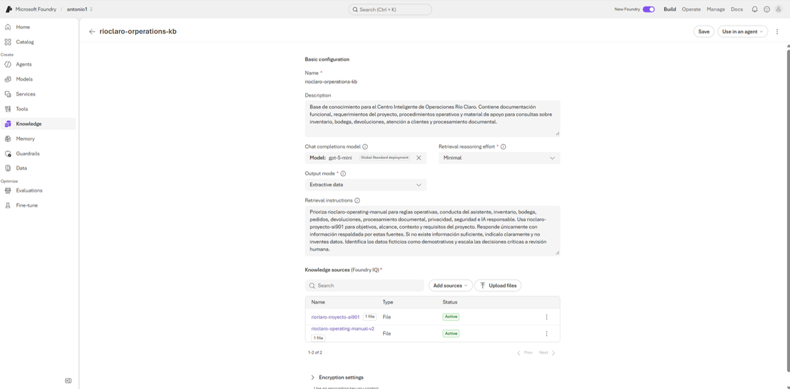

> **Figura 14a. Agente de Río Claro en Microsoft Foundry.** El agente `rioclaro-operations-agent` utiliza instrucciones específicas y la base `rioclaro-operations-kb`.

> **Figura 14b. Base de conocimiento autorizada.** La base integra el documento del proyecto AI-901 y el Manual Operativo, ambos activos.

---

## 8. Despliegue y seguridad en Azure

La solución está desplegada en Azure App Service sobre Linux y Python 3.14, con plan Basic B1 y una instancia.

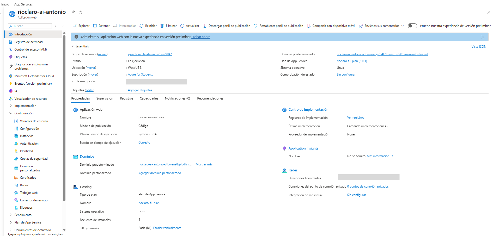

> **Figura 12a. Aplicación desplegada en Azure App Service.** La solución está en ejecución y disponible públicamente. Los identificadores administrativos se ocultaron.

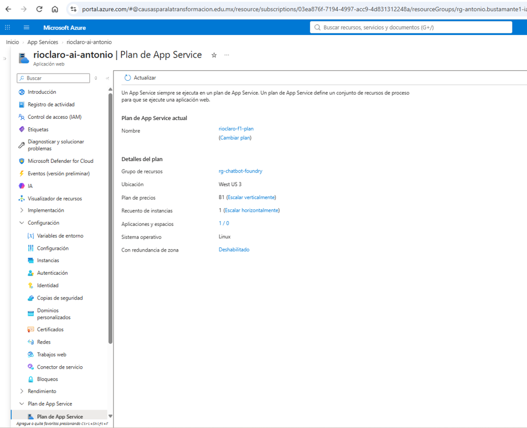

> **Figura 12b. Infraestructura de hospedaje.** Azure App Service Linux, plan Basic B1 y una instancia.

### Identidad sin claves

La aplicación usa identidad administrada y Microsoft Entra ID en lugar de incrustar API keys en el código.

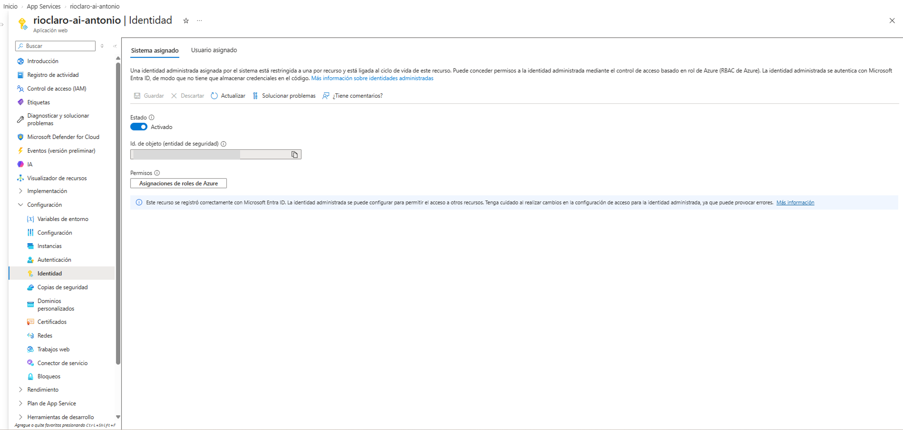

> **Figura 13. Autenticación mediante identidad administrada.** El App Service emplea una identidad asignada por el sistema y autorización basada en roles.

### Diagnóstico activo

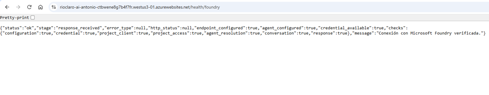

> **Figura 5. Validación activa y sanitizada de Microsoft Foundry.** `/health/foundry` confirma configuración, credencial, acceso al proyecto, resolución del agente, conversación y respuesta, sin exponer secretos.

---

## 9. IA responsable

Río Claro incorpora controles de:

| Principio | Aplicación en la solución |
|---|---|
| Confiabilidad y seguridad | No inventa existencias, importes ni folios; distingue consultas locales y documentales |
| Privacidad | Bloquea solicitudes de credenciales, nómina y datos sensibles |
| Transparencia | Muestra fuente, limitación y origen técnico |
| Inclusión | Permite texto, voz, computadora y celular |
| Supervisión humana | No autoriza pagos, devoluciones, ajustes ni decisiones críticas |
| Rendición de cuentas | Identifica datos ficticios, fuentes y límites del entorno piloto |
| Equidad | Aplica reglas homogéneas de consulta y no utiliza atributos personales protegidos para decidir |

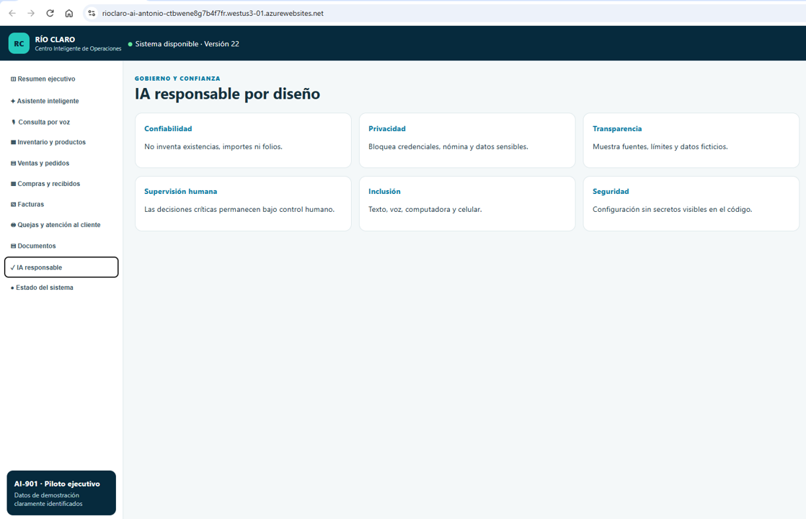

> **Figura 10. IA responsable por diseño.** La interfaz explica los controles de confiabilidad, privacidad, transparencia, supervisión humana, inclusión y seguridad.

---

## 10. Calidad y pruebas

La solución cuenta con pruebas automatizadas para API, persistencia, consultas operativas, motor analítico, enrutamiento híbrido, seguridad, Foundry y comportamiento de interfaz.

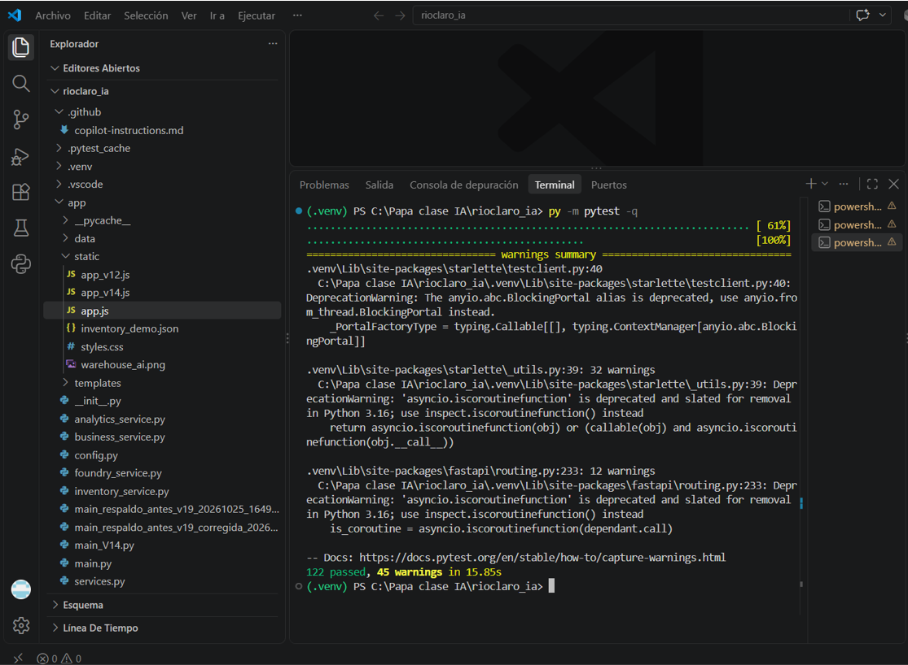

> **Figura 11. Validación automatizada.** La suite finalizó con 122 pruebas aprobadas y cero fallos. Las 45 advertencias corresponden a avisos de obsolescencia de dependencias y no impiden la ejecución.

| Indicador | Resultado |
|---|---:|
| Pruebas aprobadas | 122 |
| Pruebas fallidas | 0 |
| Advertencias | 45 |
| Estado | Aprobado |

---

## 11. Tecnologías utilizadas

- Python 3.14
- FastAPI
- Uvicorn
- HTML, CSS y JavaScript
- Microsoft Azure App Service Linux
- Microsoft Foundry
- Azure AI Projects SDK
- Microsoft Entra ID
- Identidad administrada
- Pytest
- Archivos JSON demostrativos
- Web Speech API del navegador

---

## 12. Cumplimiento del entregable

| Requisito | Cumplimiento | Evidencia |
|---|---|---|
| Aplicación funcional accesible | Sí | URL pública y Figura 1 |
| Documento exclusivamente Markdown | Sí | Este archivo `.md` |
| Imágenes y capturas | Sí | Figuras 1 a 15 |
| Explicación de la solución | Sí | Secciones 1, 5 y 6 |
| Explicación del problema | Sí | Sección 2 |
| IA responsable | Sí | Sección 9 y Figura 10 |
| Uso de IA generativa | Sí | Microsoft Foundry y Figura 4 |
| Acceso móvil y por voz | Sí | Figuras 6 y 7 |
| Evidencia de pruebas | Sí | Figura 11 |
| Acceso como usuario normal | Sí | Azure App Service y Figuras 12a-12b |

---

## 13. Limitaciones actuales

- Los datos operativos son ficticios.
- La persistencia utiliza archivos JSON locales y no una base de datos transaccional compartida.
- El esquema de compras utiliza un campo general de contraparte y no un catálogo formal de proveedores.
- Los pedidos no contienen detalle de SKU y cantidades por línea.
- Las quejas no contienen dimensión de sucursal.
- El módulo de facturas no realiza OCR ni validación fiscal.
- La protección por términos sensibles no sustituye autenticación y autorización por usuario.
- Las decisiones críticas requieren revisión humana.

---

## 14. Evolución hacia producción

1. Migrar productos, pedidos, compras y quejas a Azure SQL Database o Cosmos DB.
2. Implementar autenticación de usuarios y autorización por roles.
3. Integrar ERP, inventario, pedidos y facturación reales.
4. Incorporar procesamiento documental con extracción validada.
5. Agregar monitoreo, auditoría, respaldo y recuperación.
6. Ejecutar evaluaciones formales de calidad, seguridad, sesgo y rendimiento.
7. Definir niveles de servicio, capacidad, continuidad y soporte.
8. Mantener revisión humana en decisiones financieras y operativas.

---

## 15. Conclusiones

Río Claro demuestra una implementación funcional de inteligencia artificial aplicada a operaciones. La solución reúne experiencia web, analítica, conocimiento documental, voz, movilidad, despliegue en la nube e IA responsable.

El principal diferenciador es la arquitectura híbrida: utiliza datos estructurados cuando la pregunta es operativa, un motor analítico cuando se requieren cálculos y Microsoft Foundry cuando la consulta depende de procedimientos o conocimiento autorizado. Esta separación mejora la trazabilidad y reduce el riesgo de respuestas inventadas.

El proyecto cumple el objetivo académico como piloto funcional y establece una base clara para evolucionar hacia una solución productiva con integraciones reales, persistencia empresarial y controles de acceso.

---

## 16. Guion breve de demostración

1. Abrir la aplicación pública.
2. Mostrar el Resumen ejecutivo y las alertas.
3. Consultar `RC1007`.
4. Preguntar qué contraparte tiene más compras.
5. Mostrar una respuesta documental desde Foundry.
6. Ejecutar una consulta por voz.
7. Mostrar la experiencia móvil.
8. Registrar una queja demostrativa.
9. Analizar una factura ficticia.
10. Presentar IA responsable.
11. Mostrar `/health/foundry`.
12. Cerrar con limitaciones y evolución a producción.

---

## 17. Declaración final

La aplicación y las evidencias presentadas corresponden a una implementación funcional en fase piloto. Los datos utilizados son ficticios. No se incluyeron secretos, claves, tokens, identificadores administrativos sensibles ni información operativa real en este documento.
